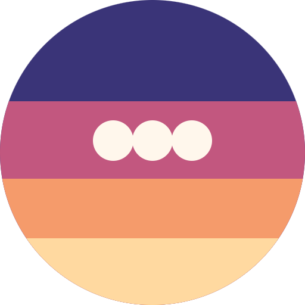

# Dusk Talk

A quiet evening chat that answers your feelings with the colors of the sky.

- ▶ **Try it:** https://hironux.github.io/dusk-talk/
- 🎬 **Demo video:** https://hironux.github.io/dusk-talk/demo.mp4
- 🎤 **Pitch video:** https://hironux.github.io/dusk-talk/pitch.mp4
- 📄 **Pitch deck (PDF):** [pitch.pdf](pitch.pdf)

## About

### End the day with a quiet talk

At night, many people want to look back on their day, but it is hard to know where to start. Dusk Talk helps you begin.

- Made for people who want to reflect on their day
- The chat starts with one gentle line
- You write freely, and the app asks you back
- Open it in the evening and talk softly

### How Dusk Talk works

You chat about your day. The app senses your feeling, replies to match it, and changes the sky color.

- Write a message or tap a starter sentence
- It senses a feeling, like tired, happy or lonely
- Its reply and follow-up questions match that feeling
- The sky and a small icon change to show the mood

### Why it matters, and what's next

Putting feelings into words can help your heart settle. Dusk Talk makes that habit gentle and easy.

- Talking through your day can feel calmer
- Switch between Japanese and English any time
- Start a new night whenever you like
- Next: more feelings and richer questions

## How it was made

Built by shaping the idea together with AI (Claude) and publishing the AI-written code.
The full conversation is in [IDEA.md](IDEA.md) (Japanese).

## Files

- `index.html` — the app (a single self-contained file)
- `IDEA.md` — the idea log
- `pitch.pdf` — the pitch deck
- `assets/logo.png` — the logo
